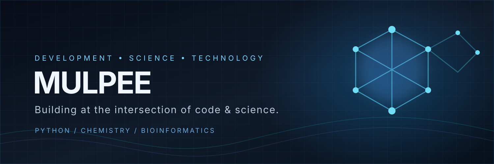

[README.md](https://github.com/user-attachments/files/34216490/README.md)
# Mulpee
Personal GitHub profile — software development, chemistry, bioinformatics &amp; ChemAnalyzer.

# Hi, I'm Mulpee 👋

### Aspiring Developer · Science & Technology Enthusiast

I’m learning to build useful software at the intersection of **programming, chemistry, and bioinformatics**.

---

## 🧪 What I'm building

### ChemAnalyzer

A desktop application project focused on exploring and identifying chemical compounds, and presenting useful chemical information.

- Molecular structure drawing and analysis
- Compound identification
- Chemistry-focused data and tools
- A Windows desktop experience

> ChemAnalyzer is a work in progress. Features and implementation may change as the project develops.

---

## ⚡ Interests

| 💻 Software development | 🧬 Science |
|:--|:--|
| Python · TypeScript · React | Chemistry · Bioinformatics |
| FastAPI · Electron | Molecular structures · Data |
| Desktop applications | Scientific computing |

## 🛠️ Technology

  
  
  
  
  
  

## 🎯 Currently focused on

- Improving my Python and software engineering skills
- Developing ChemAnalyzer step by step
- Learning more about chemistry, computational chemistry, and bioinformatics
- Building practical projects and documenting what I learn

## 📊 GitHub activity

## 📊 GitHub Activity

- 💻 Building ChemAnalyzer
- 🧪 Exploring computational chemistry
- 🧬 Learning bioinformatics
- 🚀 Improving my development skills

*Learning by building. One commit at a time.* ⚗️

